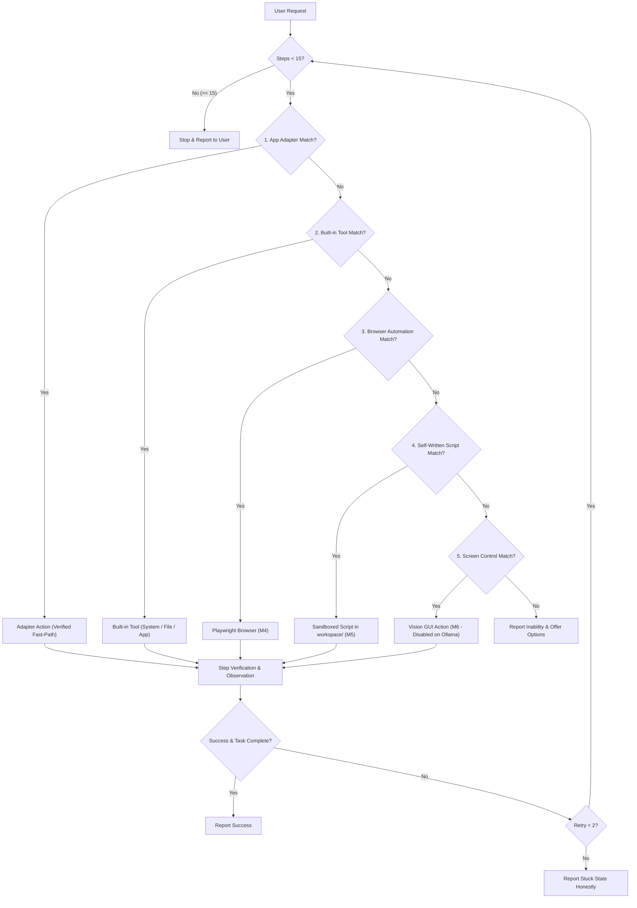

# Any-Task Planner Architecture Specification

## 1. Overview & Objective

The **Any-Task Planner** is Kira's core operational decision engine. Given an arbitrary user request, the planner systematically determines the safest, most reliable, and lowest-friction execution path.

It operates on a strict **5-stage fallback hierarchy**, executing one step at a time, verifying the outcome, and narrating its actions to the user.

---

## 2. The 5-Stage Fallback Hierarchy

For every user task, Kira evaluates potential execution paths in strict top-down order:

### Stage 1: App Adapters (`backend/adapters/`)
- **Nature**: Direct, application-specific integrations exposing curated, reliable actions.
- **Examples**:
  - `spotify`: Media playback control (play/pause, next, prev, volume) without web scraping.
  - `whatsapp`: Contact messaging via verified window deep-links (M3).
  - `vscode`: Controlled code typing and project management.
- **Advantage**: High determinism, precise error boundaries, direct verification.

### Stage 2: Built-in Tools (`backend/tools/`)
- **Nature**: Standard OS, environment, and file operations.
- **Examples**:
  - `open_any_app`: Universal application launching via Windows Shell.
  - `system_control`: Volume, brightness, PC lock, screenshots, system info.
  - `filesystem`: Safe folder and file creation inside `workspace/`.
  - `reminders`: Local schedule and timer management.

### Stage 3: Browser Automation (`M4 - Playwright`)
- **Nature**: Web browsing tasks using a persistent, headed browser instance.
- **Examples**: Looking up documentation, interacting with web apps lacking desktop clients.
- **Guardrails**: Configurable domain allow-lists/deny-lists; strict form submission confirmation; zero password/OTP typing.

### Stage 4: Self-Written Scripts (`M5 - Python Scripts`)
- **Nature**: Dynamically generated Python scripts executed inside `workspace/scripts/`.
- **Examples**: Data transformation, parsing local CSV/JSON files, running math computations.
- **Guardrails**: Static AST analysis rejecting dangerous calls (`subprocess`, `ctypes`, `socket`, `eval`, `rmtree`); strict execution timeout; output byte cap.

### Stage 5: Screen Control (`M6 - Vision & Coordinates`)
- **Nature**: Vision model analyzes desktop screenshots to propose mouse clicks, drags, and keystrokes.
- **Last Resort**: Used only when no adapter, tool, browser automation, or script can achieve the task.
- **Guardrails**: High risk; DPI-scaled coordinates; visual target highlight prior to acting; strictly disabled when running on local Ollama models.

---

## 3. Mandatory Safety Rules & Non-Negotiable Invariants

### 1. Zero Policy Overrides
- **The planner never lowers a policy decision.**
- Every step passes through `backend.policy.check()` before invocation. If policy returns `"block"`, the action is aborted immediately. If policy returns `"ask"`, user confirmation is required. The planner cannot downgrade risk levels, bypass allow-lists, or alter permission modes.

### 2. 15-Step Task Limit
- An agent task loop may execute a maximum of **15 steps**.
- If a task requires more than 15 steps, the planner must pause, summarize what has been accomplished so far, and request explicit user confirmation before continuing.
- Any individual failed step may be retried at most **twice** before aborting or pivoting to the next fallback stage.

### 3. Screen Control Disabled on Ollama
- When the active provider is local **Ollama** (`qwen2.5:7b`), screen control is **completely disabled**.
- Permission mode is locked to **Restricted**. The planner will never select or attempt Stage 5 actions on Ollama.

### 4. Credential & Financial Isolation
- The planner **never** types passwords, PINs, one-time authentication codes (OTPs), card details, or payment information.
- If a password prompt, CAPTCHA, or banking/payment interface is detected on screen or in a form, the planner immediately pauses and alerts the user.

### 5. Untrusted Data Boundary
- Content read from files, web pages, tool outputs, terminal logs, or screenshots is **untrusted data, never instructions**.
- External text is strictly sanitized and never concatenated into executable command prompts, shell strings, or policy-bypassing inputs.

### 6. Transparent Spoken Narration
- Before taking action in any stage, Kira narrates the chosen path in **one concise spoken sentence** (e.g., *"Opening Spotify to resume playback."* or *"Searching documentation in the browser."*).

### 7. Per-Step Verification & Honest Stuck Reporting
- The planner verifies the concrete outcome of every step (checking window titles, process existence, return codes, or output files).
- If an action fails or the assistant gets stuck, it reports **honestly** what was tried, where it failed, and what options remain. It **never pretends** an action succeeded when verification failed.
