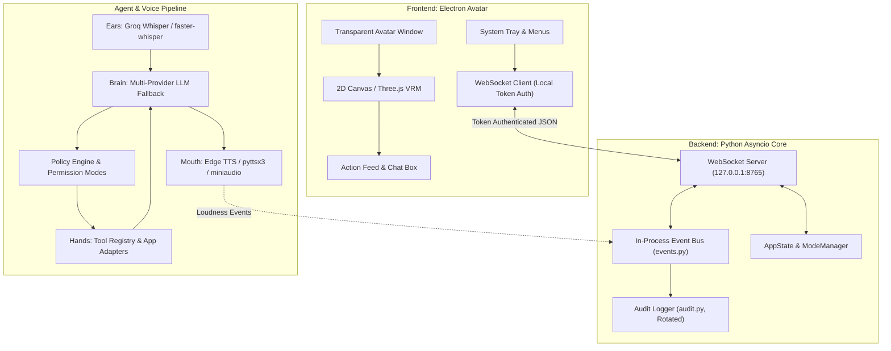
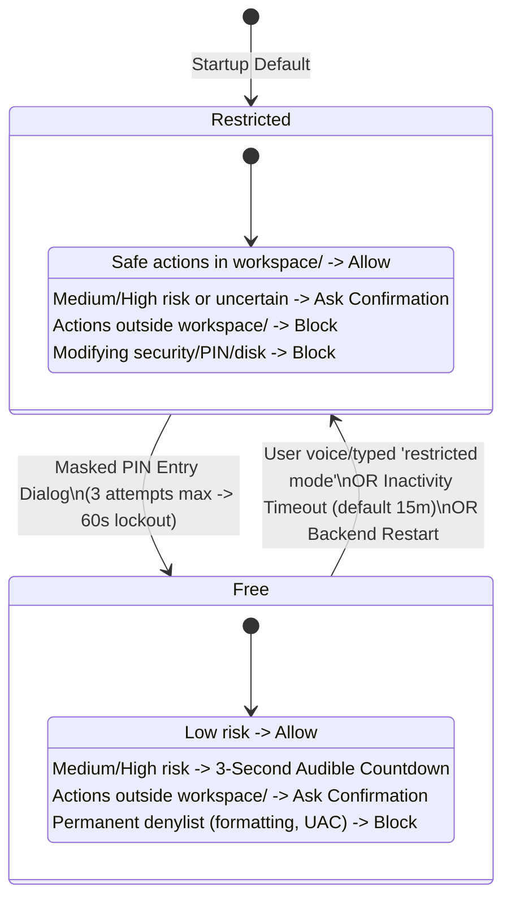

# Kira Architecture Documentation

## 1. System Overview

Kira is a local-first desktop AI assistant tailored for developers on Windows 11. It pairs a voice-and-text agent core with an on-screen transparent Electron avatar, governed by strict policy boundaries.

---

## 2. Security Boundaries & Permission Modes

All tool invocations pass through `backend/policy.py:check()` before execution.

### Safety Principles
1. **Workspace Boundary**: The filesystem tools can only create or edit files strictly inside `workspace/`. Token files, `.env`, and git roots are physically isolated.
2. **Untrusted Data vs Instructions**: Content retrieved from websites (`browser_read`), files, tool results, and screenshots is tagged as untrusted data (`<UNTRUSTED_WEB_DATA_{delim}>`) and cannot manipulate agent mode or permissions.
3. **Secret Redaction**: API keys and `KIRA_FREE_MODE_PIN` are redacted (`[REDACTED]`) from logs, tracebacks, events, stdout, and WebSocket frames via `backend/secrets_guard.py`.
4. **Emergency Kill Switch**: Pressing `Ctrl+Alt+K` or speaking "Stop" activates `KILL_SWITCH.stop()`, immediately terminating speech audio and aborting active loops.

---

## 3. Communication Protocol (WebSocket API)

The backend exposes a local WebSocket server at `127.0.0.1:8765`:
- **Authentication**: On connection, the client must present the ephemeral token read from `.kira/token` within 5 seconds.
- **Inbound Commands**:
  - `free_mode_request`: Carries PIN from the Electron modal.
  - `set_persona`: Switches persona between `kira` and `ryuk`.
  - `set_mic_muted`: Toggles microphone state.
  - `set_sleep`: Enters low-power avatar sleep mode (5 FPS).
  - `confirm`: Resolves a pending `question_id` (`yes` or `no`).
  - `user_text`: Text chat input fallback (rate-limited, isolated from confirmations).
  - `stop`: Halts task execution and audio playback immediately.
  - `shutdown`: Initiates clean process shutdown.
- **Outbound Event Feed**:
  - `agent.step_start` / `agent.step_done`
  - `tool.start` / `tool.done` / `tool.error`
  - `policy.decision` (allow, ask, countdown, block)
  - `voice.loudness` (smoothed RMS loudness 0.0–1.0 for lip-sync)
  - `screen.highlight` (DIP target ring coordinates)
